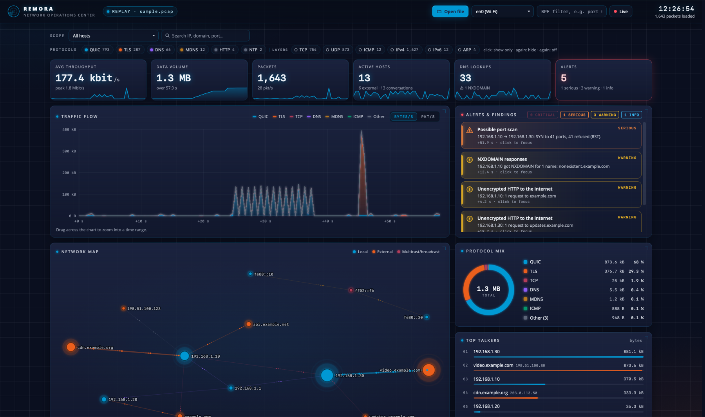

# Remora 🐟

**Rides along with Wireshark.** Remora turns packet captures into a live, NOC-style picture of your network – who talks to whom, what protocols are flowing, and what looks suspicious.



## Download

**[⬇ Download the latest Remora for macOS](https://github.com/rymdstedt/remora/releases/latest)** – a universal app for Apple Silicon and Intel, macOS 12 or later. Prefer a server? See [Docker](#docker).

1. Open the DMG and drag **Remora** into **Applications**.
2. The first launch is blocked because the app is not notarized by Apple. Open **System Settings › Privacy & Security**, click **Open Anyway**, then **Open**. This is only needed once.

## Docker

Run Remora on a home server, NAS or Raspberry Pi and open it from a browser. Images for **amd64** and **arm64**:

```bash
# Linux host – watch the host's real network interfaces (open http://localhost:8787 on that machine)
docker run -d --name remora --network host -e HOST=127.0.0.1 --restart unless-stopped ghcr.io/rymdstedt/remora

# Any Docker host – analyze capture files in the browser
docker run -d --name remora -p 127.0.0.1:8787:8787 ghcr.io/rymdstedt/remora
```

Or with Docker Compose – save as `compose.yaml` and run `docker compose up -d`:

```yaml
services:
  remora:
    image: ghcr.io/rymdstedt/remora:latest
    network_mode: host          # the host's own interfaces – Linux only
    environment:
      HOST: 127.0.0.1           # reachable from this machine only
      # HOST: 0.0.0.0           # reachable from other devices …
      # REMORA_ALLOWED_HOSTS: nas.lan,192.168.1.5   # … under these names
      # REMORA_LIVE: "off"      # file viewer only, no live capture
    restart: unless-stopped
```

| Setting | Default | Meaning |
|---|---|---|
| `HOST` | `0.0.0.0` | address to listen on inside the container |
| `PORT` | `8787` | port |
| `REMORA_ALLOWED_HOSTS` | – | extra names allowed in the address bar, comma-separated (`localhost` always works) |
| `REMORA_LIVE` | on | `off` disables live capture and keeps the file viewer |

**Good to know**
- Live capture of your LAN needs `--network host` on Linux. On Docker Desktop (Mac/Windows) the container only sees Docker's internal network, so use it for capture files there – or use the Mac app.
- **Anyone who can open the page can watch live traffic.** Keep it on localhost or a trusted network, or put a login-protected reverse proxy in front. Use `REMORA_LIVE=off` to share only the file viewer.
- The container runs as an unprivileged user; packet capture only gets the `CAP_NET_RAW` permission that Docker grants by default.

## What it shows

- **KPIs** with sparklines: throughput, data volume, packets, active hosts, DNS lookups, alerts
- **Traffic flow** stacked by protocol – drag across it to zoom into a time range
- **Alerts & findings**: port scans, host sweeps, failed DNS lookups (NXDOMAIN), unencrypted HTTP, cleartext protocols, large uploads, traffic spikes
- **Network map** with animated packet flows – color shows the protocol, direction shows where the bytes go
- **Protocol mix, top talkers and a live event feed** (DNS lookups, TLS server names, HTTP requests, new hosts)
- **Tables** for conversations, DNS, TLS/SNI and HTTP

## Filtering

Click a protocol chip to show only that protocol, click again to hide it, once more to turn the filter off – combine as many as you like. Layer chips work like Wireshark display filters: `TCP` includes TLS and HTTP, `UDP` includes DNS and QUIC. Clicking a host, alert, talker or chart segment narrows every view to it; `Esc` clears all filters.

## Live capture

Opening `.pcap` / `.pcapng` files works out of the box – drop a file on the window, press **⌘O**, or use **Open With › Remora** in Finder.

Live capture uses Wireshark's `dumpcap`. Install [Wireshark](https://www.wireshark.org) and keep **Install ChmodBPF** checked so captures work without admin rights. Then pick an interface, optionally add a capture filter such as `port 53`, and press **Live**.

## Privacy

Everything runs locally: captures are parsed in the app (or in your own Docker container) and are never uploaded anywhere. The Mac app opens no network ports; the Docker image serves the UI on port 8787 only where you publish it.

## Known limitations

- No TCP reassembly: HTTP and TLS are read from the first segment (enough for request lines and server names).
- Server names inside QUIC (HTTP/3) are not decoded; DNS answers provide host names instead.
- Alerts are heuristics with fixed thresholds, not an intrusion detection system.
